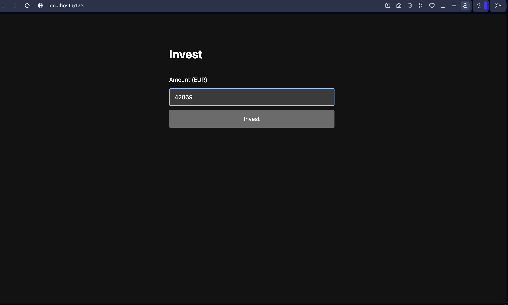
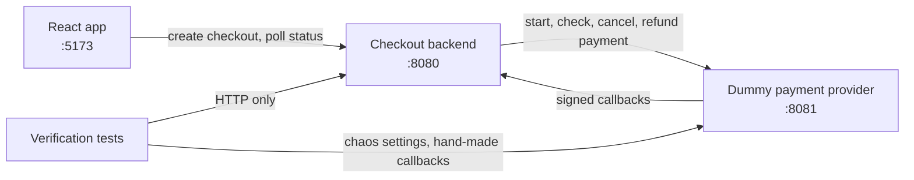

# Checkout status PoC

Customers invest an amount and watch the status of their checkout until it succeeds, fails
or expires. A Spring Boot backend takes the payment through a dummy payment provider and
tracks the status from the provider's callbacks.

The hard part is that callbacks can arrive late, out of order, more than once, with a bad
signature, or not at all. The backend has to end up with the right status anyway, and never
charge or refund a customer twice.



## How it fits together



1. The app creates a checkout. The backend saves it as PENDING and starts a payment at the provider.
2. The provider moves the payment to PROCESSING, then SUCCEEDED or FAILED, and sends a signed
   callback for each change.
3. The backend checks each callback (signature, duplicate, amount, order) and updates the status.
4. A scheduled job covers missing callbacks: it asks the provider for the status, expires
   checkouts that were never paid, and refunds payments that succeeded after expiry.
5. The app polls the backend every 2 seconds and shows the status. It never decides a payment
   result itself.

## Projects

| Folder | What | Port | README |
|---|---|---|---|
| [`contract/`](contract/) | The source of truth: statuses, rules and both APIs | | [states.md](contract/states.md) |
| [`backend/`](backend/) | Spring Boot checkout service | 8080 | [backend/README.md](backend/README.md) |
| [`dummy-provider/`](dummy-provider/) | Fake payment provider with chaos modes | 8081 | [dummy-provider/README.md](dummy-provider/README.md) |
| [`web/`](web/) | React + TypeScript app | 5173 | [web/README.md](web/README.md) |
| [`verification/`](verification/) | Independent black-box tests | | [verification/README.md](verification/README.md) |

### contract

- [`states.md`](contract/states.md): the statuses, the allowed status changes, how to process a
  callback, the scheduled job, refunds, and the money rules.
- [`checkout-api.yaml`](contract/checkout-api.yaml): the backend's API, used by the apps.
- [`provider-api.yaml`](contract/provider-api.yaml): the provider's API, including the chaos and
  test endpoints.

API clients are generated from these files, and every other project is built to match them.

### backend

Creates checkouts, takes payments through the provider, and processes callbacks in one
transaction with optimistic locking. Every callback that passes the signature check is
stored with its outcome (APPLIED, IGNORED_STALE or FLAGGED) and can be read at
`GET /checkouts/{id}/events`. Money is integer cents plus a currency code.
See [backend/README.md](backend/README.md).

### dummy-provider

An in-memory payment provider. Its `PUT /admin/chaos` endpoint makes it duplicate, reorder,
drop or wrongly sign callbacks, fail payments, or refuse cancels. `POST /admin/send-callback`
sends a callback of your choice on demand. See [dummy-provider/README.md](dummy-provider/README.md).

### web

Customers enter an amount in EUR, then see the status until it is final.
See [web/README.md](web/README.md) for screenshots.

### verification

JUnit tests that check the running backend and provider over HTTP only, written from the
contract without looking at the other projects' code. See
[verification/README.md](verification/README.md).

### mobile (not built yet)

A Flutter version of the app is planned on port 5174. Its branch has no commits yet.

## How it was built: one Claude Code agent per project

A person wrote the contract. Five Claude Code agents then built the projects in parallel,
each from the contract alone. Agent definitions live in [`.claude/agents/`](.claude/agents/),
and the shared rules are in [`CLAUDE.md`](CLAUDE.md).

| Agent | Builds | Definition |
|---|---|---|
| `backend-dev` | `backend/` | [backend-dev.md](.claude/agents/backend-dev.md) |
| `provider-sim` | `dummy-provider/` | [provider-sim.md](.claude/agents/provider-sim.md) |
| `react-dev` | `web/` | [react-dev.md](.claude/agents/react-dev.md) |
| `flutter-dev` | `mobile/` | [flutter-dev.md](.claude/agents/flutter-dev.md) |
| `test-writer` | `verification/` | [test-writer.md](.claude/agents/test-writer.md) |

```bash
claude --worktree backend --agent backend-dev    # and so on, one terminal per agent
```

How the agents were kept apart and checked:

- **Own worktree and branch.** Each agent ran in its own git worktree on a `worktree-<name>`
  branch, all started from the same commit on main. No agent could see another's code.
- **Own folder.** Each agent works only in its folder. If the contract looks wrong, it stops
  and asks instead of working around it.
- **Contract is read-only.** [`.claude/settings.json`](.claude/settings.json) denies edits to
  `contract/`, `CLAUDE.md` and `.claude/`, denies reading `.env`, and blocks `git push`.
  Commands not on the allow list need a person's approval.
- **Independent tests.** `test-writer` reads only `CLAUDE.md` and `contract/`, never the other
  projects' code, so its tests check the contract rather than the implementation.
- **Built against mocks.** The apps were developed against a Prism mock of the contract, and the
  backend and provider tests each use a fake of the other service, so no agent waited on another.
- **Reviewed by a person.** Each agent committed to its own branch. A person reviewed each diff,
  checked that nothing outside the agent's folder changed, and merged the branches into main.

## Run it

You need Java 21+ and Node 20+. Copy `.env.example` to `.env` and put a random signing secret
in it (`openssl rand -hex 32`). Then, one terminal each:

```bash
set -a; source .env; set +a; cd dummy-provider && ./mvnw spring-boot:run
set -a; source .env; set +a; cd backend && ./mvnw spring-boot:run -Dspring-boot.run.profiles=fast
cd web && npm install && npm run dev                  # http://localhost:5173
```

With both services running, run the independent tests:

```bash
cd verification && ./mvnw test
```

## Break it on purpose

Turn on chaos, then invest again in the app:

```bash
curl -X PUT localhost:8081/admin/chaos -H 'Content-Type: application/json' \
  -d '{"modes":["duplicate","reverse"],"delaySeconds":1}'
```

| Modes | What you see |
|---|---|
| `duplicate`, `reverse`, `drop`, `badSignature` | The app still ends on "Payment received". The events show how the backend coped. |
| `fail` | "Payment failed. You have not been charged." |
| `[]` with `"delaySeconds":15` | The checkout expires after about 10 seconds. |
| `cancelTooLate` with `"delaySeconds":15` | It expires, the payment succeeds anyway, and the backend refunds it. |

Settings only apply to payments created after you set them. To reset, send `{"modes":[]}`.

To see what happened, open `http://localhost:8080/checkouts/<checkoutId>/events`. The app
doesn't show the checkout ID, so copy it from the status requests in the browser's
DevTools Network tab.
