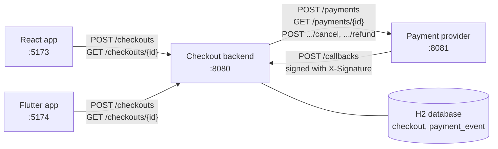
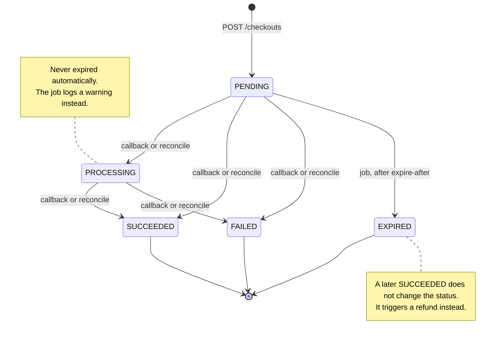
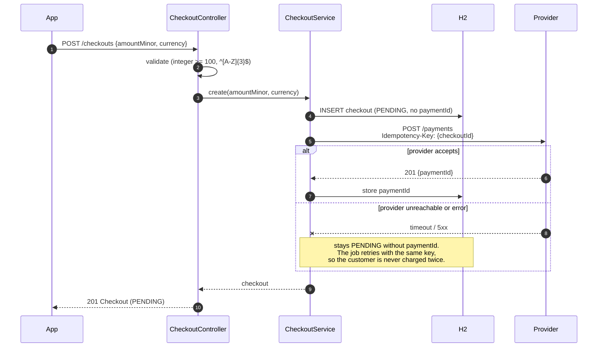
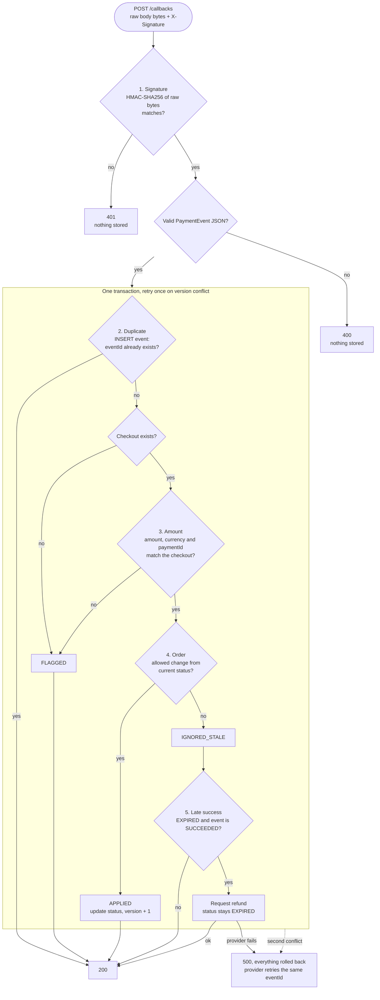
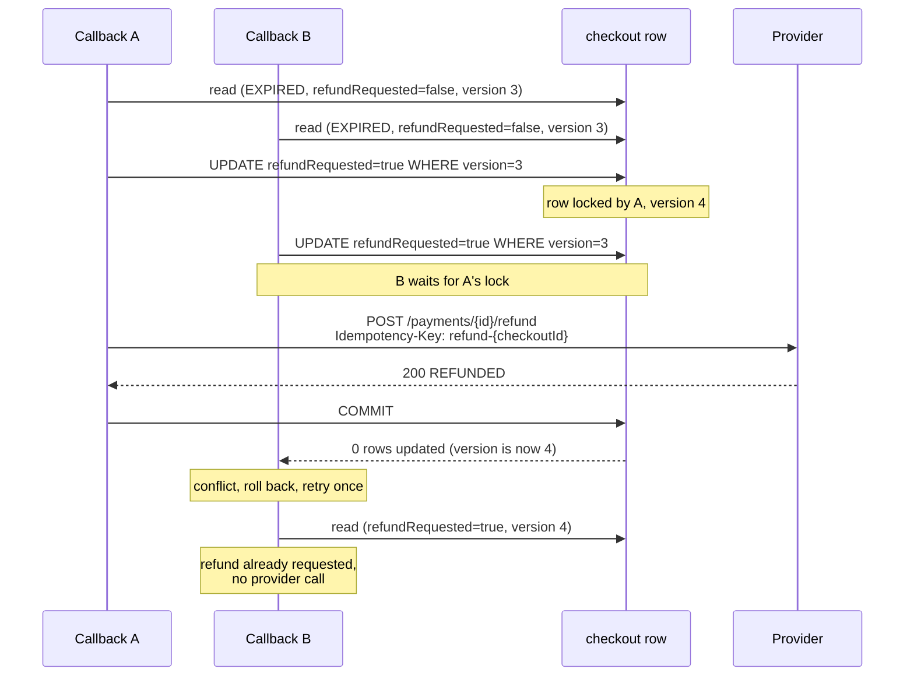
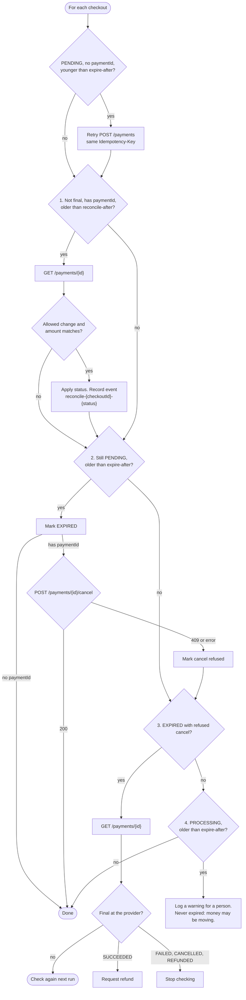
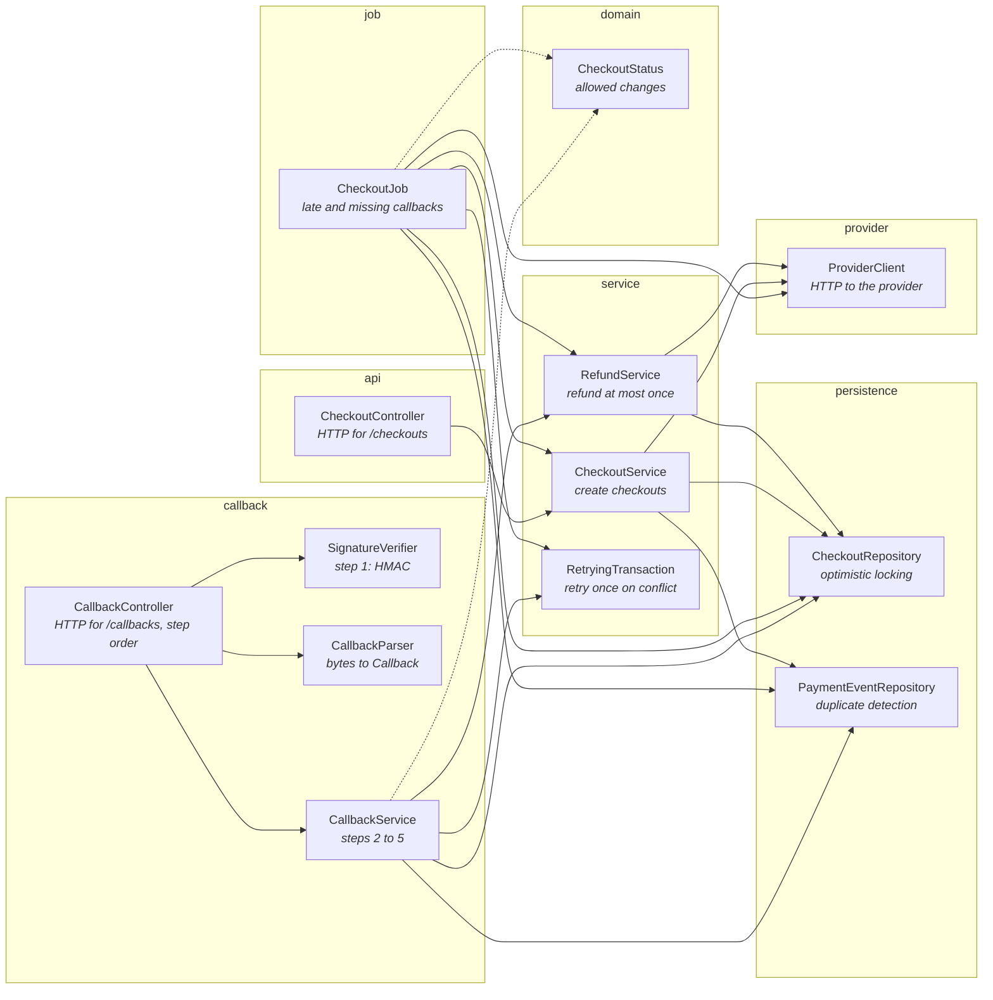
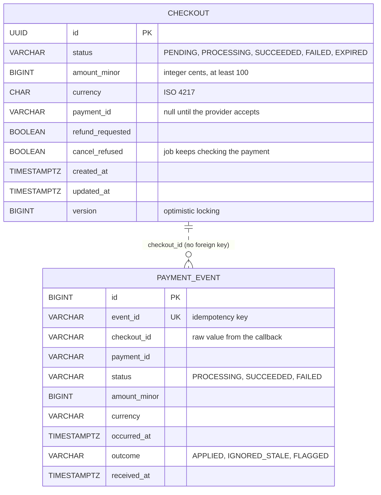

# Checkout backend

Spring Boot 4 / Java 21 service for the checkout status PoC. Implements `contract/checkout-api.yaml`
and the rules in `contract/states.md`. Port 8080.

## Run

```bash
set -a; source ../.env; set +a        # PROVIDER_SIGNING_SECRET is required; the app won't start without it
./mvnw spring-boot:run -Dspring-boot.run.profiles=fast
```

The `fast` profile uses the test timings (reconcile 5s, expire 10s, job every 2s).
The provider URL is `provider.base-url` (default `http://localhost:8081`).
The database is in-memory H2, so data is lost on restart. Schema: `src/main/resources/db/migration`.

## Tests

```bash
./mvnw test
```

The provider is faked with WireMock. Time is controlled with a test clock, and the scheduled job is
called directly, so the tests don't wait for real minutes.

## How it works

### The system



Callbacks can arrive late, out of order, more than once, or not at all. The backend has to
cope with all four.

### Checkout statuses

Only these status changes are allowed (`CheckoutStatus`). SUCCEEDED, FAILED and EXPIRED are final.



### Creating a checkout



### Processing a callback (POST /callbacks)

Step 1 runs before anything is parsed. Steps 2 to 5 run in one database transaction, retried once if
another transaction updated the same checkout first.



Duplicates, stale and flagged events return 200 on purpose: an error would make the provider keep
retrying a callback we have already dealt with.

### Why there is never more than one refund request

Two late successes for the same expired checkout can arrive at the same moment (or a callback and
the job). `RefundService` updates the checkout row **before** calling the provider. That update
takes the row lock, so the second transaction has to wait, then fails its version check, retries,
and sees `refundRequested = true`.



The Idempotency-Key is a second safety net: even if the backend did call twice, the provider would
refund only once.

### The scheduled job

Every `checkout.job-interval`, for each checkout that is not final, or is EXPIRED with a refused
cancel. Ages are measured from `createdAt`.



### Classes and what each one is responsible for

Arrows mean "calls". Each class has one job, described in its Javadoc.



`SchedulingConfig` runs `CheckoutJob` on its interval. `AppConfig` provides the clock and CORS.

### Database

Created by Flyway (`V1__create_checkout_and_payment_event.sql`).



`checkout_id` has no foreign key on purpose, so a callback for an unknown checkout can still be
recorded as FLAGGED.

## Where the rules live

| Rule (states.md) | Code |
|---|---|
| Allowed status changes | `domain/CheckoutStatus` |
| Creating a checkout | `service/CheckoutService` |
| Callback step 1 (signature, raw bytes) | `callback/CallbackController`, `callback/SignatureVerifier` |
| Callback steps 2–5 (one transaction, retry once) | `callback/CallbackService`, `service/RetryingTransaction` |
| Refunds (at most one request per checkout) | `service/RefundService` |
| Scheduled job | `job/CheckoutJob` |
| Optimistic locking (`version`) | `persistence/CheckoutRepository#update` |

## Decisions where the contract was silent (agreed before building)

1. A SUCCEEDED callback for an EXPIRED checkout is recorded as `IGNORED_STALE`. A refund is
   requested and the status stays EXPIRED.
2. A callback for an unknown checkoutId is stored as `FLAGGED` and returns 200 (no foreign key on events).
3. A callback whose paymentId differs from the checkout's is `FLAGGED`. If the checkout has no
   paymentId yet, it takes the one from the callback.
4. The refund call happens inside the callback transaction. If it fails, everything rolls back and
   the response is 500, so the provider retries with the same eventId. A second optimistic-locking
   conflict also returns 500.
5. The job retries POST /payments for PENDING checkouts without a paymentId. If one reaches
   expire-after with no paymentId, it is expired without a cancel.

Also: ages are measured from `createdAt`. A cancel that fails with a network error or 5xx is handled
like a 409. The provider's final statuses are SUCCEEDED, FAILED, CANCELLED and REFUNDED. Reconcile
also checks amount and currency. A signed but malformed callback returns 400.
