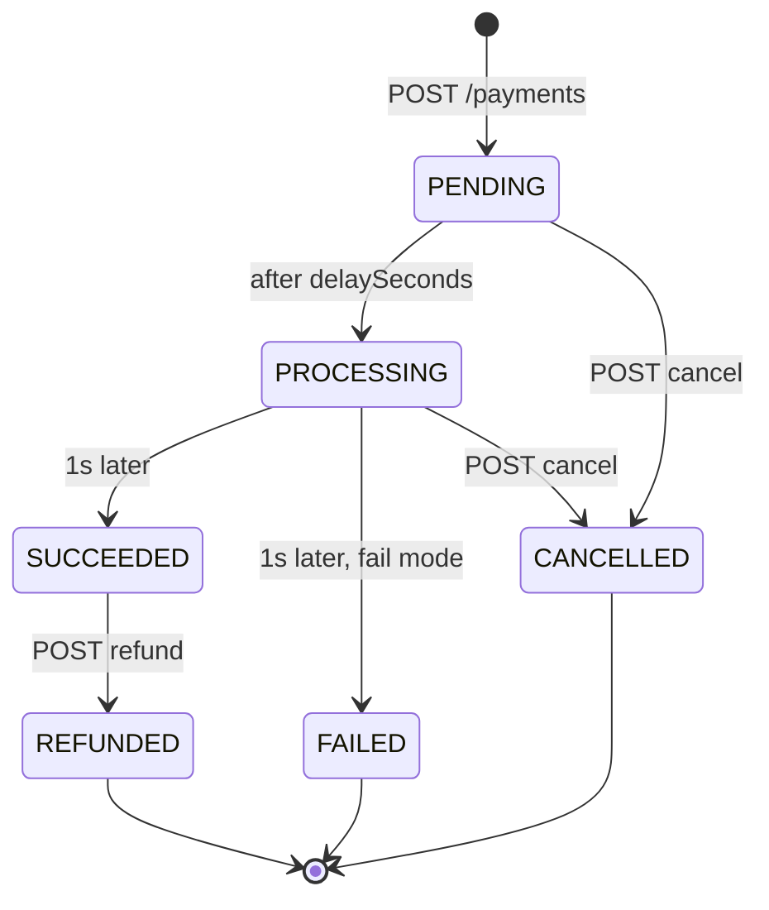
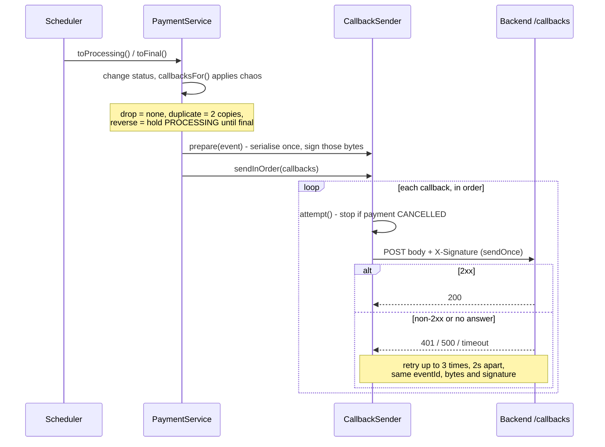
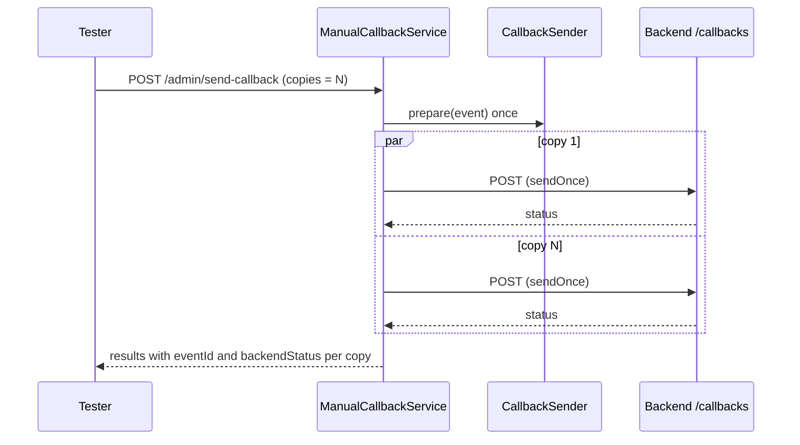

# dummy-provider

Fake payment provider for the checkout PoC. Implements `contract/provider-api.yaml` on port 8081.
Everything is in memory; restarting forgets all payments and chaos settings.

```bash
set -a; source ../.env; set +a   # needs PROVIDER_SIGNING_SECRET
./mvnw spring-boot:run
./mvnw test
```

## Behaviour

- `POST /payments` creates a PENDING payment (201). The same `Idempotency-Key` returns the
  existing payment (200), even if the body differs.
- PENDING → PROCESSING after `delaySeconds` → SUCCEEDED (FAILED in `fail` mode) 1 second later.
  Each change POSTs a `PaymentEvent` with a new `eventId` to the payment's `callbackUrl`.
- The body is serialised once; `X-Signature` is the lowercase hex HMAC-SHA256 of those exact bytes.
- A callback without a 2xx answer (including no answer at all) is retried 3 times, 2 seconds apart,
  with byte-identical body and signature.
- Chaos settings (modes and `delaySeconds`) are copied into each payment when it is created, so
  changing them never affects existing payments.
- `cancel`: PENDING/PROCESSING → CANCELLED (200), already CANCELLED → 200, anything else → 409.
  Cancelling stops all further changes, callbacks and pending retries. With `cancelTooLate` every
  cancel gets 409 and the payment completes normally.
- `refund`: only a SUCCEEDED payment can be refunded (→ REFUNDED, refundCount 1). A key that already
  produced the refund returns 200 again with no second refund. A key is only remembered when it
  actually refunded, so a key that got 409 early still works once the payment has succeeded.
- `/admin/send-callback` ignores chaos and payment status, sends all copies at once (each on its
  own thread, released together), does not retry, and reports each backend status.

## Diagrams

### Payment lifecycle

Only PROCESSING, SUCCEEDED and FAILED send a callback. CANCELLED and REFUNDED are visible only
through `GET /payments/{paymentId}`.



### Automatic callbacks and retries

What happens at each status change. The scheduler thread never waits on HTTP; sending runs on
a separate virtual thread.



### `/admin/send-callback`

All copies share one body and signature, and are released together by a single gate.
No retries, and chaos settings are ignored.



## Interpretations (contract is silent)

- `reverse`: the PROCESSING callback is held back and sent straight after the final callback.
- `duplicate`: each callback is sent twice in a row, same eventId and bytes; each copy retries on its own.
- `badSignature` / `validSignature: false`: signed with a random key generated at startup.
- `send-callback` reports `backendStatus: 0` for a copy that got no HTTP answer (connection refused / timeout).

## Config

| Property | Default | Notes |
|---|---|---|
| `provider.signing-secret` | `${PROVIDER_SIGNING_SECRET}` | Required. Startup fails without it. |
| `provider.final-after` | 1s | Contract value. Tests shorten it. |
| `provider.retry-interval` | 2s | Contract value. Tests shorten it. |
| `provider.max-retries` | 3 | Contract value. |
| `provider.callback-timeout` | 5s | Per-attempt HTTP timeout. |
