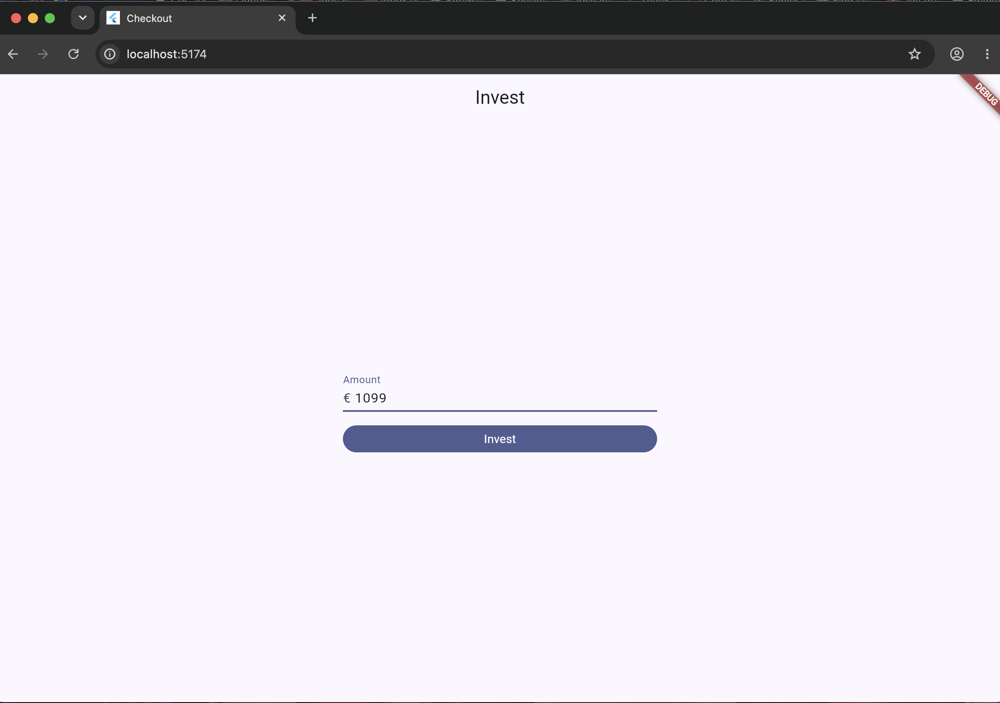
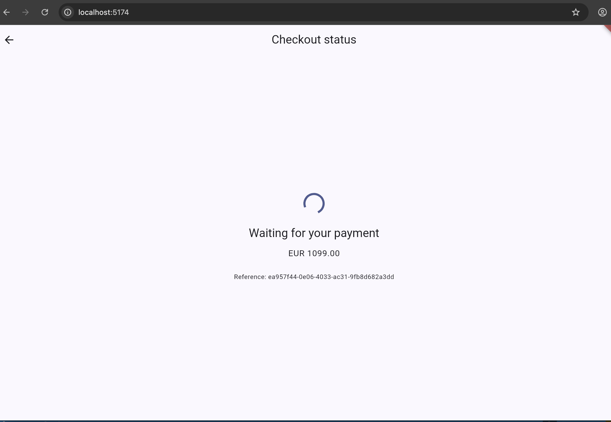
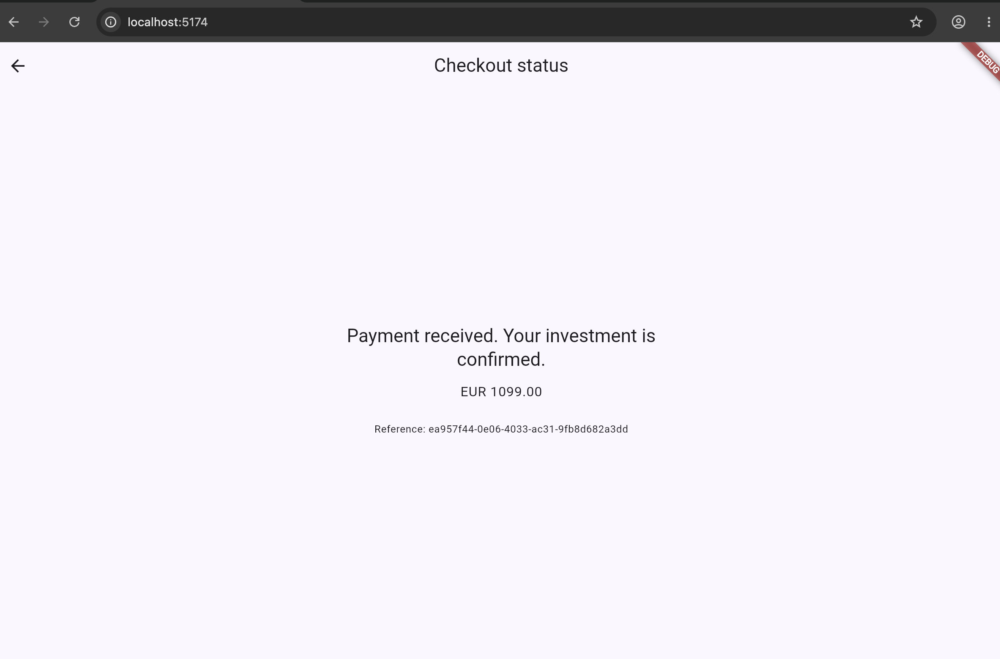
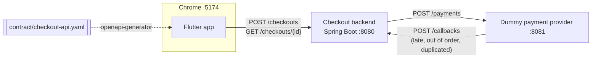
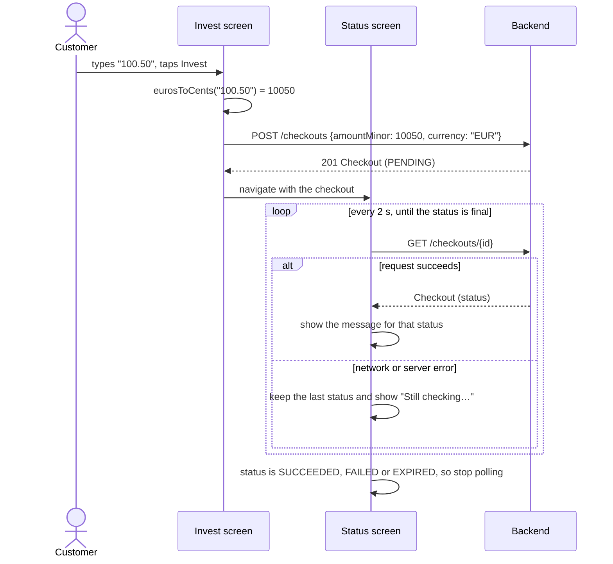
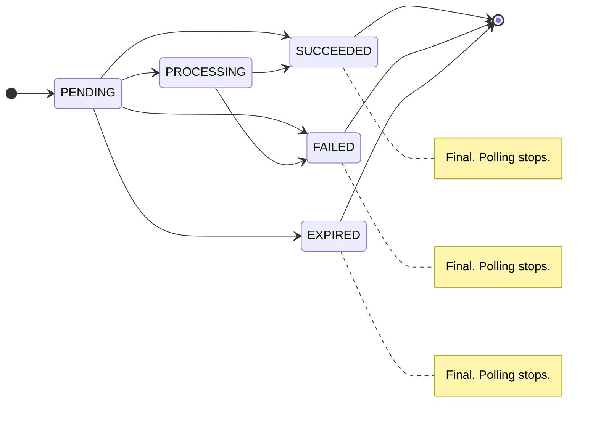
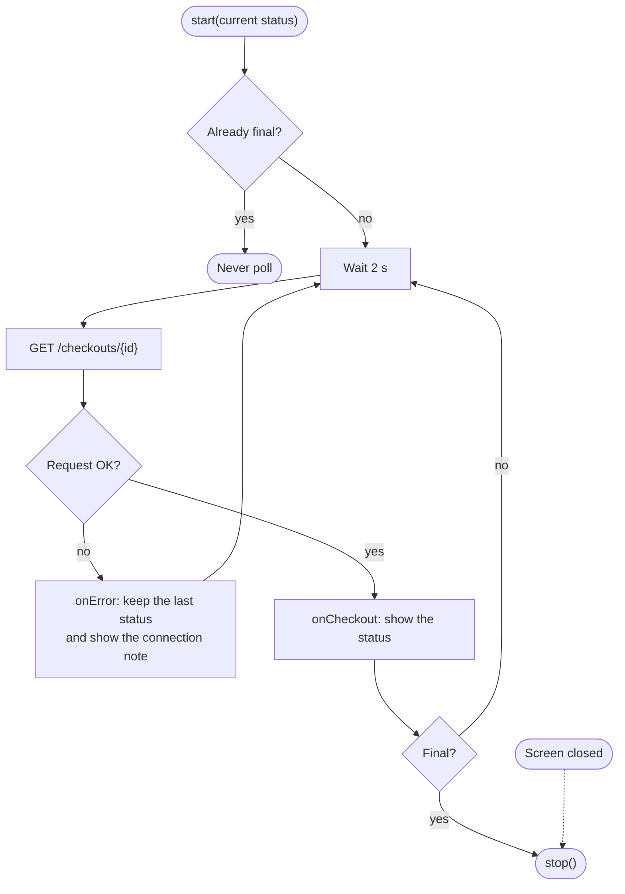
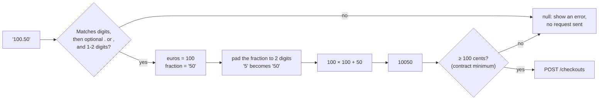
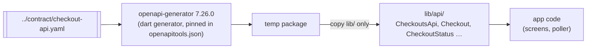
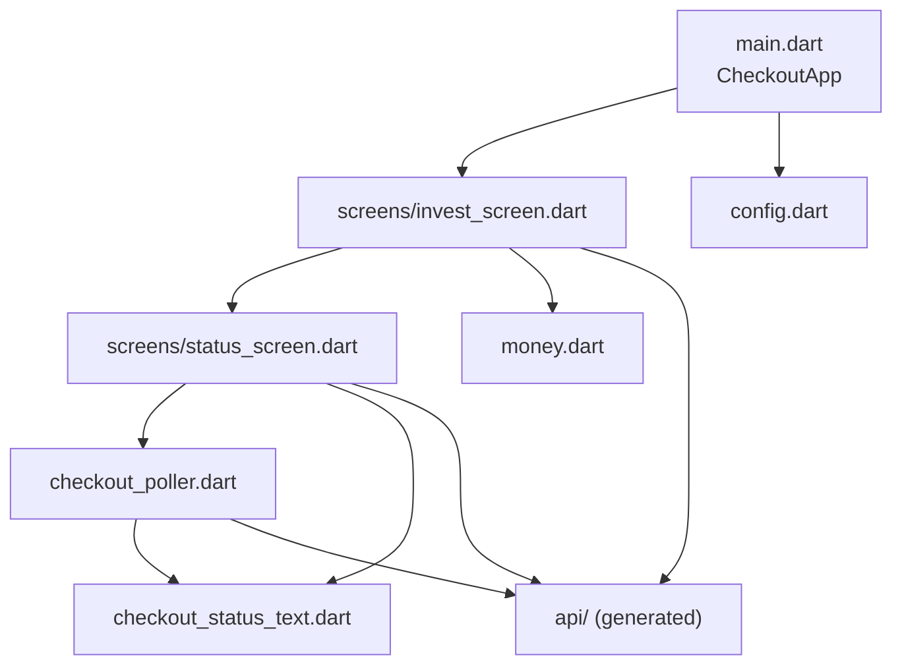

# Checkout mobile app (Flutter)

Customers start an investment checkout and watch its payment status. The app has two
screens and runs in Chrome for the PoC. It **only shows the status the backend returns**.
It never decides or guesses a payment result.

| 1. Invest | 2. Waiting (PENDING) | 3. Confirmed (SUCCEEDED) |
|---|---|---|
|  |  |  |
| Enter an amount in euros. `1099` is sent as `amountMinor: 109900`. | `POST /checkouts` returned PENDING. The app polls every 2 s. | The backend reported SUCCEEDED, a final status, so polling stopped. |

## Quick start

```bash
# Against the real backend (http://localhost:8080)
flutter run -d chrome --web-port 5174

# Against a mock built from the contract (no backend needed)
npm install
npx prism mock -d ../contract/checkout-api.yaml          # terminal 1, port 4010
flutter run -d chrome --web-port 5174 \
  --dart-define=API_BASE_URL=http://127.0.0.1:4010        # terminal 2
```

The backend must allow CORS from `http://localhost:5174`.

## Where the app fits



The app talks only to the backend. Callbacks, duplicates, stale events, refunds and expiry
are all the backend's job. The app just reads the result.

## Flow: invest, then poll



## Statuses and what the customer sees

The status changes come from `contract/states.md`. The app never makes these changes
itself. It shows whichever status the backend reports.



| Status | Final? | Message |
|---|---|---|
| PENDING | No | Waiting for your payment |
| PROCESSING | No | Your payment is being processed |
| SUCCEEDED | Yes | Payment received. Your investment is confirmed. |
| FAILED | Yes | Payment failed. You have not been charged. |
| EXPIRED | Yes | This checkout expired. If you were charged, you will be refunded automatically. |

PENDING can go straight to SUCCEEDED, as in the screenshots above, because the PROCESSING
callback may arrive late or not at all. If the backend sets `refundRequested`, the screen
also shows "A refund has been requested."

## How polling works

`lib/checkout_poller.dart` waits for each request to finish before it schedules the next
one. Requests never overlap, so an older response can never overwrite a newer one.



## Money: euros to cents without floating point

Money is integer cents plus a currency code. `lib/money.dart` parses the text the customer
typed. It never uses `double`, so values like `0.29` and `1.15`, which go wrong in
floating point, come out exact.



| Input | Result |
|---|---|
| `100.50`, `100.5`, `100,50` | `10050` |
| `0.29` | `29` |
| `1099` | `109900` |
| `abc`, `-1`, `1.234`, `1e3`, `1,000.00` | rejected |

## Generated API client

`lib/api/` is generated from the contract. **Never hand-edit it.** After any contract
change, regenerate it:

```bash
npm install
npm run generate-api        # runs tool/generate_api.sh
```



The generated code is excluded from `flutter analyze`.

## Configuration

| `--dart-define` | Default | Purpose |
|---|---|---|
| `API_BASE_URL` | `http://localhost:8080` | Backend base URL |

The poll interval (2 s), the currency (EUR) and the minimum amount (100 cents) are set in
`lib/config.dart`.

## Code layout



```
mobile/
  lib/
    api/                        generated client (do not edit)
    config.dart                 API_BASE_URL, poll interval, currency, minimum amount
    money.dart                  eurosToCents, formatMoney (integers only)
    checkout_status_text.dart   status to message, isFinalStatus
    checkout_poller.dart        sequential 2 s polling, stops on a final status
    screens/invest_screen.dart
    screens/status_screen.dart
  test/                         unit and widget tests
  tool/generate_api.sh          regenerates lib/api/
  docs/screenshots/             images used in this README
```

## Tests

```bash
flutter test                    # Dart VM
flutter test --platform chrome  # compiled to JS and run in Chrome
```

| File | Covers |
|---|---|
| `test/money_test.dart` | Euros-to-cents conversion, floating-point traps, invalid input |
| `test/checkout_poller_test.dart` | Polls every 2 s, stops on each final status, keeps going after errors, `stop()` |
| `test/status_screen_test.dart` | The message for every status, the PENDING → PROCESSING → SUCCEEDED flow, the connection note, the refund note |
| `test/invest_flow_test.dart` | `100.50` is posted as `{amountMinor: 10050, currency: "EUR"}`, validation, backend errors |

## Troubleshooting

| You see | Likely cause |
|---|---|
| "Could not start the checkout. Please try again." | The backend returned an error (5xx) or isn't running. Check the backend logs. |
| "Trouble reaching the server. Still checking…" | A status request failed. The app keeps the last status and retries. |
| Prism always shows PENDING | Prism's static mode always returns the first example. Start it with `-d` for random statuses. |
