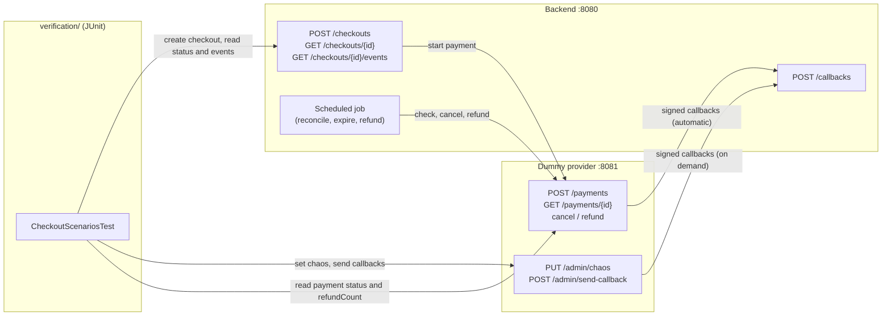
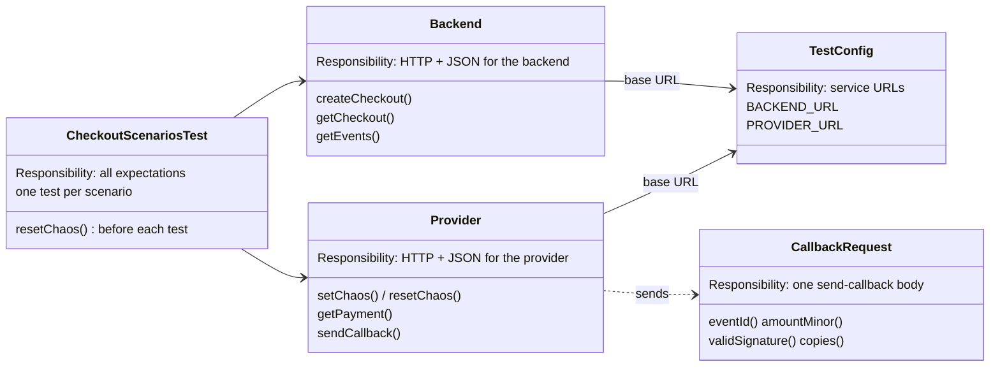
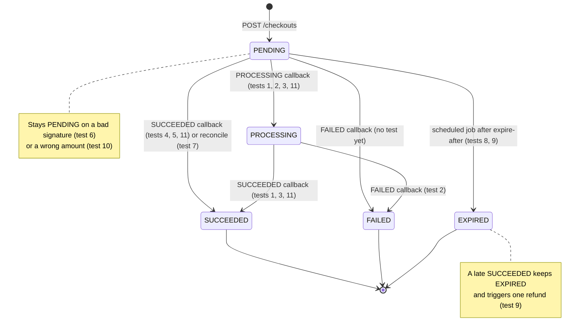
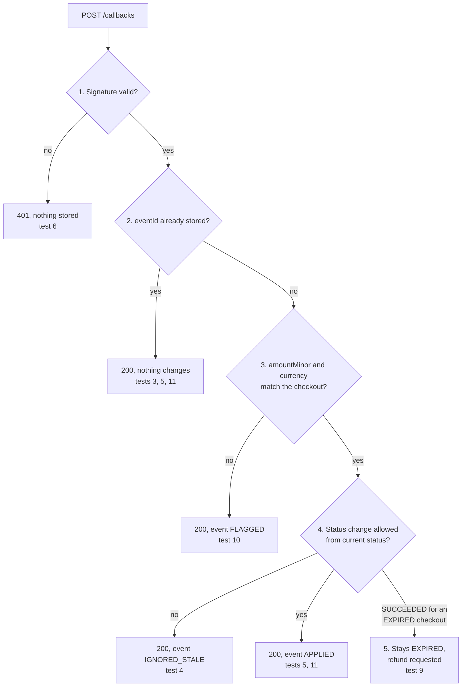
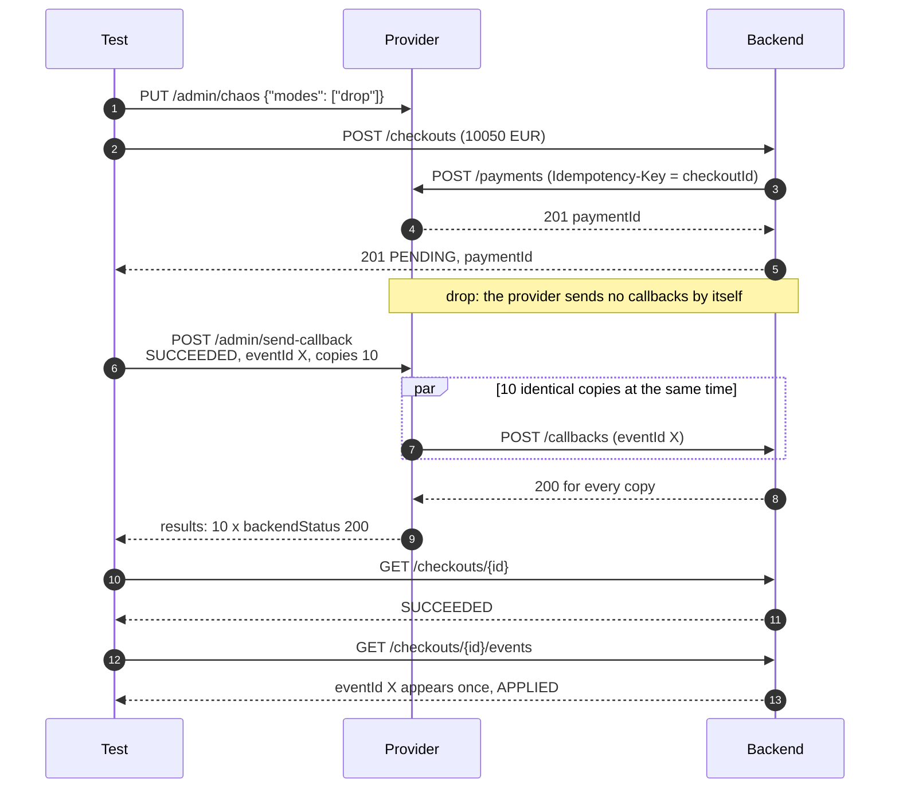
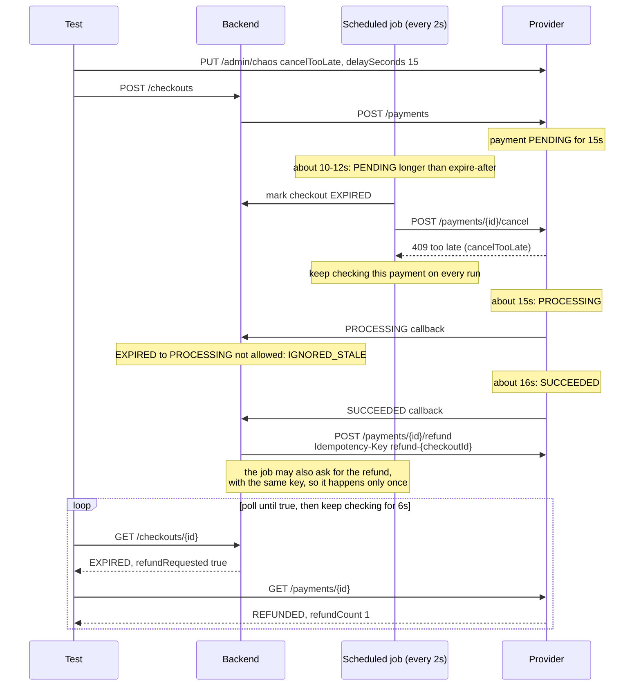

# Verification: black-box tests

These tests check the checkout backend and the dummy payment provider **only over HTTP**,
using what `contract/` says. They don't use any code from `backend/` or `dummy-provider/`.

Stack: Java 21, JUnit 5, RestAssured, Awaitility, AssertJ, Maven wrapper.

## How the tests reach the services

The tests never call backend code directly. They drive the system from the outside: they
create checkouts on the backend, and use the provider's `/admin` endpoints to set chaos modes
and to send hand-made callbacks. Then they read the results back from both services.



## How the test code is split

Each class has one job (see the class-level Javadoc). Only `CheckoutScenariosTest` decides
whether the system behaved correctly. The two clients only make calls and turn JSON into records.



## Before you run them

Both services must already be running:

| Service | Default URL | Notes |
|---|---|---|
| Backend | http://localhost:8080 | Must use the **`fast`** profile (reconcile-after 5s, expire-after 10s, job-interval 2s). |
| Dummy provider | http://localhost:8081 | Nothing to configure for callbacks: the backend sends its `callbackUrl` with each payment. |

Both must use the same `PROVIDER_SIGNING_SECRET` (any test value). The tests don't need the
secret: they ask the provider to sign callbacks via `POST /admin/send-callback`.

## Running

```bash
cd verification
./mvnw test
```

Use other URLs with system properties or environment variables (system properties win):

```bash
./mvnw test -Dbackend.url=http://localhost:9080 -Dprovider.url=http://localhost:9081
# or
BACKEND_URL=http://localhost:9080 PROVIDER_URL=http://localhost:9081 ./mvnw test
```

Run one scenario:

```bash
./mvnw test -Dtest='CheckoutScenariosTest#lateSuccessIsRefunded'
```

To only check that the tests compile: `./mvnw test-compile`.

A full run takes about 1 minute, mostly waiting for the scheduled job (expiry, late success).

## Important: one test at a time

Chaos settings on the provider are global. The tests run one at a time (JUnit parallel
execution is off), and each test resets chaos to `{"modes": [], "delaySeconds": 1}` before
it starts. **Don't run two test runs at the same time against the same provider**, and don't
change chaos by hand during a run.

## Scenarios

All in `CheckoutScenariosTest`. Amounts are `10050 EUR`.

| # | Test | Setup | Expected |
|---|---|---|---|
| 1 | `happyPath` | default chaos | Checkout ends SUCCEEDED. |
| 2 | `failedPayment` | `fail` | FAILED. |
| 3 | `duplicateCallbacks` | `duplicate` | SUCCEEDED; every eventId appears once in `/events` (checked for 3s so late copies are included). |
| 4 | `reversedCallbacks` | `reverse` | SUCCEEDED; the PROCESSING event is `IGNORED_STALE`. |
| 5 | `concurrentIdenticalCallbacks` | `drop`, then send-callback SUCCEEDED, one eventId, `copies=10` | Every copy answered 200; SUCCEEDED; that eventId appears once (`APPLIED`). |
| 6 | `badSignature` | `drop`, then send-callback with `validSignature=false` | Backend answered 401; still PENDING; nothing stored for that eventId. |
| 7 | `droppedCallbacksReconciled` | `drop` | SUCCEEDED via the scheduled job; event `reconcile-{checkoutId}-SUCCEEDED` exists. |
| 8 | `expiry` | `delaySeconds=60` | EXPIRED; provider payment CANCELLED. |
| 9 | `lateSuccessIsRefunded` | `cancelTooLate`, `delaySeconds=15` | Stays EXPIRED; `refundRequested=true`; provider payment REFUNDED with `refundCount=1` (and stays so for 6s). |
| 10 | `wrongAmountIsFlagged` | `drop`, then send-callback SUCCEEDED with `amountMinor` 10049 | Answered 200; event `FLAGGED`; still PENDING. |
| 11 | `randomOrderAndDuplicates` (×20) | `drop`, then PROCESSING and SUCCEEDED callbacks in random order with random duplicates (same eventIds, 1–3 copies each) | All answered 200; SUCCEEDED within 3s of the first callback; the SUCCEEDED event is `APPLIED`. The random seed is printed for each run. |

### Which tests cover which status change

The allowed status changes from `contract/states.md`, labelled with the tests that drive the
checkout through them. Most tests only assert the final status, not each step. Final statuses
never change.

Gap: no test sends FAILED straight to a PENDING checkout (PENDING → FAILED). Test 2 reaches
FAILED through PROCESSING.



### What happens to each callback, and which test checks it

The backend handles every callback in the order set out in `states.md`. Each exit is checked
by at least one test.



### Two ways the tests produce callbacks

Most tests let the provider send callbacks itself, shaped by a chaos mode (`duplicate`,
`reverse`, `fail`, ...). Tests 5, 6, 10 and 11 turn automatic callbacks off with `drop` and
send exactly the callbacks they want through `POST /admin/send-callback`. This is test 5:



### The slowest test: late success (test 9)

Tests 7, 8 and 9 rely on the scheduled job, using the `fast` profile timings. Test 9 is the
trickiest: the payment completes after the checkout has already expired, so the customer
paid for an investment that was never made and must get exactly one refund.



### "Still PENDING" checks

Tests 6 and 10 check PENDING before the scheduled job could reconcile the checkout. The test
fails if that check happens 5s (`reconcile-after` in the fast profile) or more after the
create request was sent, rather than passing for the wrong reason.

## Assumptions

- The backend stores the paymentId when the checkout is created (states.md, "Creating a
  checkout"). Tests that need it wait up to 3s for it.
- Test 7 relies on the reconcile eventId format `reconcile-{checkoutId}-{status}` from states.md.
