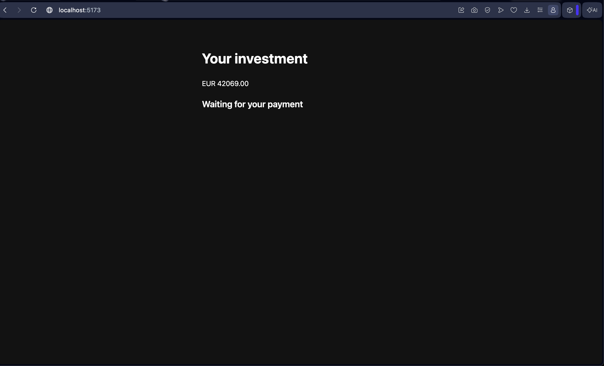
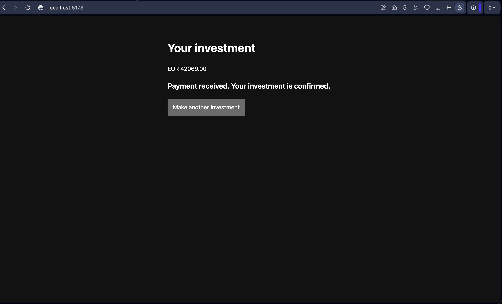

# Checkout web app

React + TypeScript + Vite. Customers invest an amount in EUR and watch the checkout status.
The app only shows the status the backend returns. It never decides a payment result.

## Screenshots

1. Enter an amount and invest.

   

2. The status screen polls the backend while the payment is pending.

   

3. The final status, once the backend has confirmed the payment.

   

## Run

```bash
npm install
npm run dev            # http://localhost:5173, backend at http://localhost:8080
```

Backend URL: set `VITE_API_BASE_URL` (see `.env.example`). Default `http://localhost:8080`.

### Without a backend

```bash
npm run mock           # Prism mock from ../contract/checkout-api.yaml on :4010
npm run dev:mock       # app pointed at the mock
```

The static mock always answers PENDING, so the status screen keeps polling.

## Scripts

| Script | What |
|---|---|
| `npm run generate-api` | Regenerate `src/api/` from `../contract/checkout-api.yaml` (needs Java). Never hand-edit `src/api/`. |
| `npm test` | Unit and component tests (Vitest) |
| `npm run build` | Type-check and build |
| `npm run lint` | oxlint (skips generated code) |

## Layout

- `src/api/` generated client (typescript-fetch, version pinned in `openapitools.json`)
- `src/lib/money.ts` euros string to integer cents, no floating point
- `src/lib/poll.ts` polls GET /checkouts/{id} every 2 s until a final status
- `src/lib/status.ts` status messages and final statuses
- `src/screens/` Invest and Status screens
